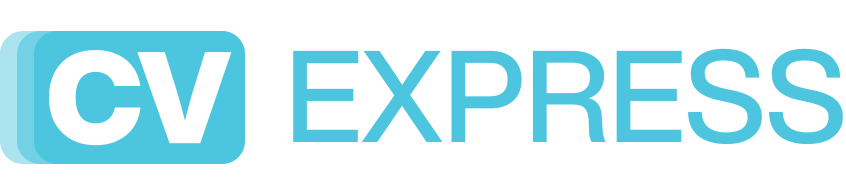

<p align="center">
  
</p>

<p align="center">
  Tu CV, una vez. Adaptado a cada oferta, en cada idioma, listo en PDF.<br>
  Sin cuentas, sin servidores: tus datos se quedan en tu navegador.
</p>

<p align="center"><em><a href="#english">English below</a></em></p>

---

## Qué es

Chamba Vitae es un editor de CV que funciona en el navegador. Rellenas tu información una vez y desde ahí:

- **Cambias de idioma** con un clic (cada texto guarda su versión en español, inglés…).
- **Creas variantes** para distintos tipos de oferta (diseño, tienda, oficina…) ocultando lo que no toca, sin duplicar nada.
- **Reordenas** secciones y entradas arrastrando.
- **Importas** tu CV actual desde PDF o Word para no empezar de cero.
- **Descargas el PDF** con texto real (seleccionable y legible por los filtros automáticos de las empresas).

## Primeros pasos

La primera vez que abras la app verás una guía rápida; puedes volver a verla con el botón **?** de la barra superior. En resumen:

1. **Empieza por tu CV actual.** *Archivo → Importar CV (PDF, Word…)* o arrastra el archivo a la ventana. La app reconoce nombre, contacto, secciones, fechas y entradas. Revisa el resultado: la conversión es automática y no siempre acierta.
   *¿Prefieres empezar de cero?* *Archivo → CV en blanco*. El CV de ejemplo (Alex Romero) te sirve de referencia.
2. **Edita a la izquierda; a la derecha ves el PDF.** Pulsa una sección para abrirla. Escribe `**así**` para poner negrita. Arrastra los puntitos ⋮⋮ para reordenar.
3. **Traduce.** Cambia el *Idioma del CV* arriba (ES / EN). Los campos sin traducir salen en ámbar con el texto del otro idioma como pista; el botón `ES → EN` lo copia tal cual si es igual en los dos.
4. **Crea una variante por tipo de oferta.** En la pestaña *Variantes*, *Nueva variante*. Luego, en *Contenido*, el ojo 👁 oculta una sección o entrada **solo en esa variante**. Cada variante puede tener su propio cargo.
5. **Ajusta el diseño.** Pestaña *Diseño*: tipografía (o cualquier fuente instalada en tu equipo), tamaño del nombre, colores y foto.
6. **Descarga el PDF.** En el diálogo de impresión elige *Guardar como PDF* y desactiva *Encabezados y pies de página*.
7. **Haz copia de seguridad.** *Archivo → Exportar JSON* de vez en cuando. Si cambias de navegador o de ordenador, *Importar JSON* y listo.

> **Privacidad:** no hay registro ni servidor. Todo se guarda en el almacenamiento local de tu navegador y en los JSON que tú exportes. Si borras los datos del navegador sin haber exportado, se pierden.

### Importar desde PDF o Word: qué esperar

Funciona sin IA y sin enviar nada fuera: lee el texto del archivo y aplica reglas.

- ✅ PDF con texto real (exportados desde Word, Canva, Figma, Google Docs…), incluso a dos columnas.
- ✅ Word `.docx` y texto plano `.txt`.
- ⚠️ Reconoce títulos de sección habituales en español e inglés (*Experiencia, Formación, Idiomas, Skills…*). Si tu CV usa otros, puede mezclar secciones.
- ❌ PDF escaneados (son imágenes, no tienen texto) y Word antiguo `.doc` (guárdalo como `.docx`).
- La foto y las negritas no se importan.

## Usarla en tu ordenador

Necesitas [Node.js](https://nodejs.org) 18 o superior.

```bash
git clone https://github.com/miauro/chamba-vitae.git
cd chamba-vitae
npm install
npm run dev        # abre http://localhost:5173
```

Otros comandos: `npm run build` genera la versión publicable en `dist/`; `npm run preview` la sirve en local.

## Publicarla en GitHub Pages

1. Haz un fork (o sube tu copia) del repositorio.
2. En *Settings → Pages → Build and deployment*, elige **GitHub Actions**.
3. Cada `git push` a `main` la publica con [.github/workflows/deploy.yml](.github/workflows/deploy.yml).

## Tus datos y el repositorio

Si guardas tus CVs dentro de la carpeta del proyecto, ponlos en `mis-cvs/`: está en [.gitignore](.gitignore) y nunca se sube. También se ignoran los `cv-*.json` exportados y los PDF/Word que dejes en la raíz.

## Para desarrolladores

React 18 + TypeScript + Vite. Sin backend.

| Archivo | Qué hace |
|---|---|
| [src/types.ts](src/types.ts) | Formato del CV (el JSON que se exporta). Los textos son `{ "es": "…", "en": "…" }`. |
| [src/model.ts](src/model.ts) | Creación y validación de datos (`normalizeCV` acepta JSON importados). |
| [src/importer.ts](src/importer.ts) | Importación desde PDF (pdf.js), Word (`.docx`) y texto. Se carga solo al usarla. |
| [src/components/Preview.tsx](src/components/Preview.tsx) + [src/styles/cv.css](src/styles/cv.css) | La hoja A4: lo que se ve es lo que se imprime. |
| [src/components/Editor.tsx](src/components/Editor.tsx) | Formularios del contenido. |
| [src/components/Tour.tsx](src/components/Tour.tsx) | Guía de bienvenida. |
| [src/i18n.ts](src/i18n.ts) | Textos de la interfaz (ES/EN) y etiquetas fijas del CV («Hoy», «Present»…). |

---

## English

**Chamba Vitae** is a browser-based CV editor. Fill in your details once, then switch the CV language in one click, create variants for different kinds of jobs by hiding what does not fit, reorder by dragging, import your current CV from PDF or Word, and download a PDF with real, selectable text. No accounts, no servers: your data stays in your browser and in the JSON files you export.

**Getting started:** a quick tour appears on first launch (replay it with the **?** button). Import your CV from *File → Import CV*, or start from *File → Blank CV*. Edit on the left; the right-hand sheet is exactly the PDF. Untranslated fields are highlighted in amber. Use *Variants* plus the eye icon to tailor the CV per job. Download with *Download PDF* → *Save as PDF* (turn off *Headers and footers*). Export the JSON regularly as a backup.

**Run locally:** `npm install && npm run dev`. **Deploy:** set *Settings → Pages* to **GitHub Actions** and push to `main`.
